<div align="center">


[](https://www.instagram.com/tsukini_22/) [](https://www.roblox.com/communities/14006959/Xartania) [](https://tsukini22.github.io/my-universe/)

</div>

### About me
- I build my own tools from scratch (working... mostly o_o), with as few dependencies as possible: a C++20 library ([libutils](https://github.com/TsukiNi22/libutils)), a neural network library, a programming language, a shell, a text editor...
- Every project follows the same way of working: CMake + `clang++`, GoogleTest, my own coding style checked by [xstyle](https://github.com/TsukiNi22/xstyle), CI/CD in my own [Docker images](https://github.com/TsukiNi22/docker-image), signed RPM / DEB / Arch packages and an HTML doc on GitHub Pages.
- Daily driver: Fedora on Wayland ([wayland-desktop](https://github.com/TsukiNi22/wayland-desktop), set up by [dump](https://github.com/TsukiNi22/dump)).
- Owner of [Xartania Game](https://www.roblox.com/communities/14006959/Xartania) (Roblox, Luau).

### Stack

       <br>        <br>         

## Pinned

<p align="center">
<a href="https://github.com/TsukiNi22/libutils"></a>
<a href="https://github.com/TsukiNi22/c2dmp-hsm"></a>
<a href="https://github.com/TsukiNi22/s.o.s">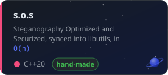</a>
<a href="https://tsukini22.github.io/my-universe/">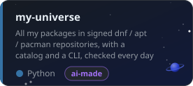</a>
<a href="https://github.com/TsukiNi22/docker-image"></a>
<a href="https://github.com/TsukiNi22/cpp_project_template"></a>
</p>

## Packages

> [!TIP]
> Every package below is in one set of signed repositories for Fedora, Debian/Ubuntu and Arch: [](https://tsukini22.github.io/my-universe/)
>
> ```bash
> # register every package repository, then install (or: apt install / pacman -S)
> curl -fsSL https://tsukini22.github.io/my-universe/install.sh | bash -s
> sudo dnf install libutils
> ```

<p align="center">
<a href="https://github.com/TsukiNi22/libutils"></a>
<a href="https://tsukini22.github.io/my-universe/"></a>
<a href="https://github.com/TsukiNi22/banana-brain"></a>
<a href="https://github.com/TsukiNi22/context-forge">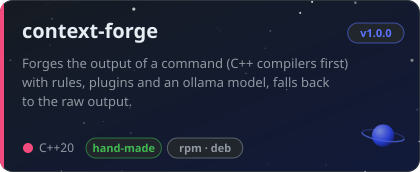</a>
<a href="https://github.com/TsukiNi22/xstyle"></a>
<a href="https://github.com/TsukiNi22/xdesk"></a>
</p>

<p align="center"><sub><b>hand-made</b>: written by hand, the AI only helped · <b>ai-made</b>: mostly written with an AI, on top of my skills and style in <a href="https://github.com/TsukiNi22/ai-utils">ai-utils</a> · versions updated every week from my-universe</sub></p>


## Algorithms

<p align="center">
<a href="https://github.com/TsukiNi22/c2dmp-hsm"></a>
<a href="https://github.com/TsukiNi22/s.o.s"></a>
</p>

## Dev environment

<p align="center">
<a href="https://github.com/TsukiNi22/cpp_project_template"></a>
<a href="https://github.com/TsukiNi22/c_project_template"></a>
<a href="https://github.com/TsukiNi22/docker-image"></a>
<a href="https://github.com/TsukiNi22/ai-utils"></a>
<a href="https://github.com/TsukiNi22/dump"></a>
<a href="https://github.com/TsukiNi22/wayland-desktop"></a>
</p>

<details>
<summary><b>From scratch / school projects</b> (some are unfinished or on hold)</summary>
<br>

<p align="center">
<a href="https://github.com/TsukiNi22/my_language"></a>
<a href="https://github.com/TsukiNi22/42sh"></a>
<a href="https://github.com/TsukiNi22/Corewar"></a>
<a href="https://github.com/TsukiNi22/my_text_editor"></a>
<a href="https://github.com/TsukiNi22/compressor"></a>
<a href="https://github.com/TsukiNi22/my_lib_c"></a>
<a href="https://github.com/TsukiNi22/asm_64bit_pool"></a>
<a href="https://github.com/TsukiNi22/MAGIC"></a>
<a href="https://github.com/TsukiNi22/aoc"></a>
</p>

</details>

## Activity

<p align="center">
</p>

<div align="center">
<br>

[](https://tsukini22.github.io/my-universe/) [](https://github.com/TsukiNi22?tab=followers) [](https://github.com/TsukiNi22?tab=repositories&sort=stargazers) 

</div>
